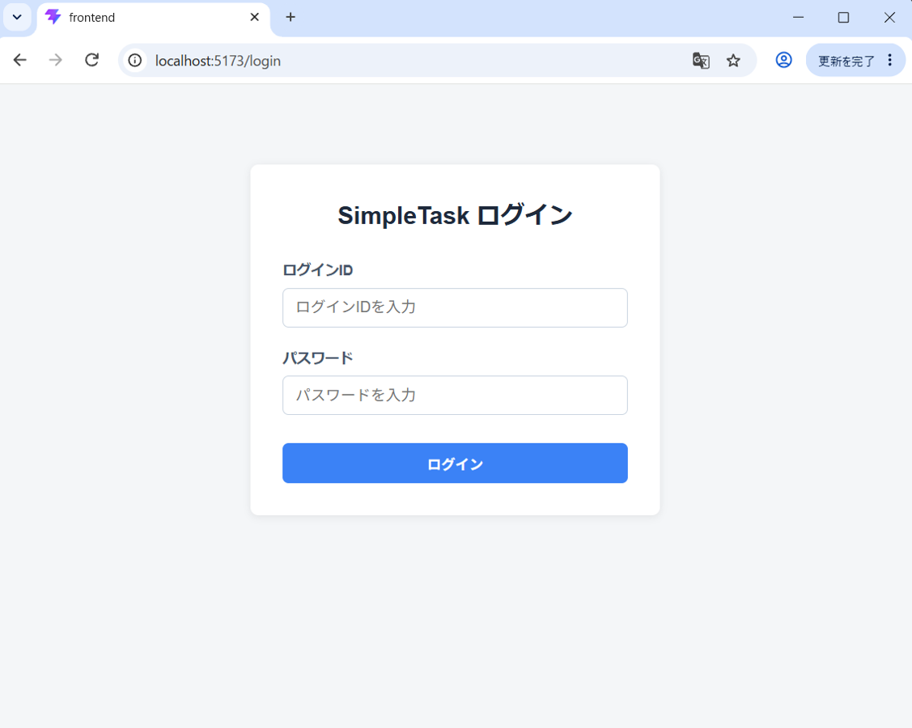
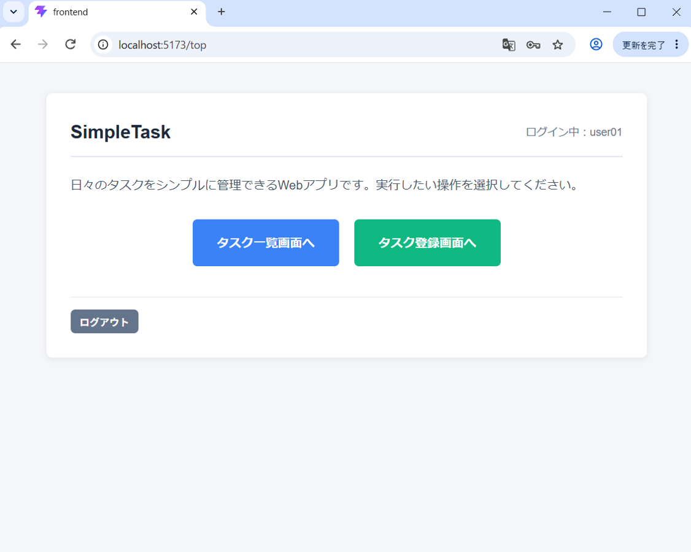
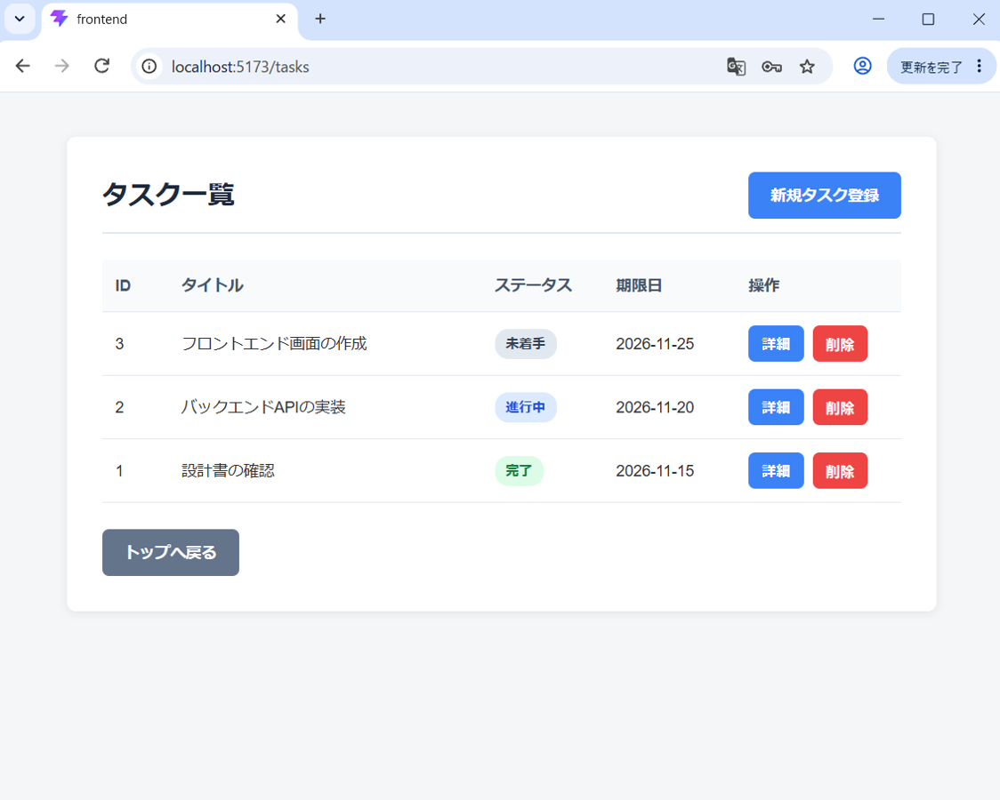
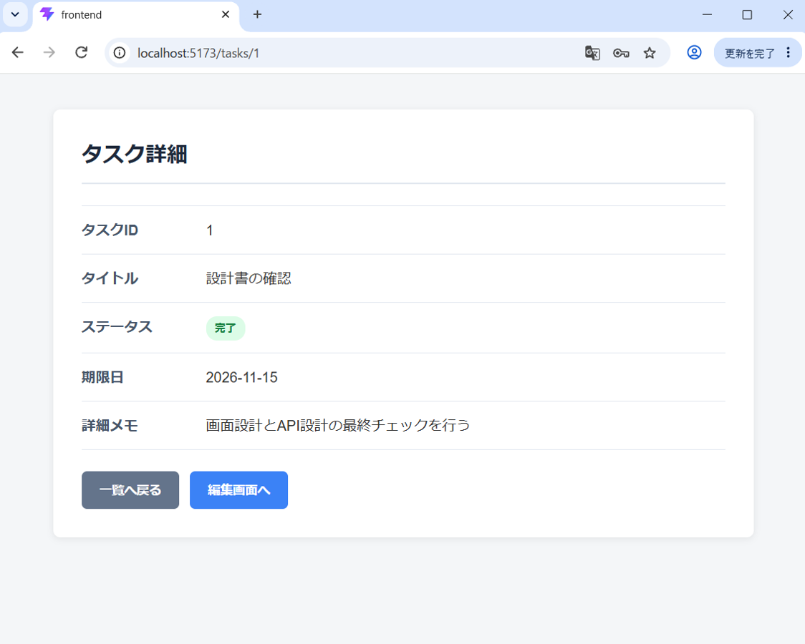
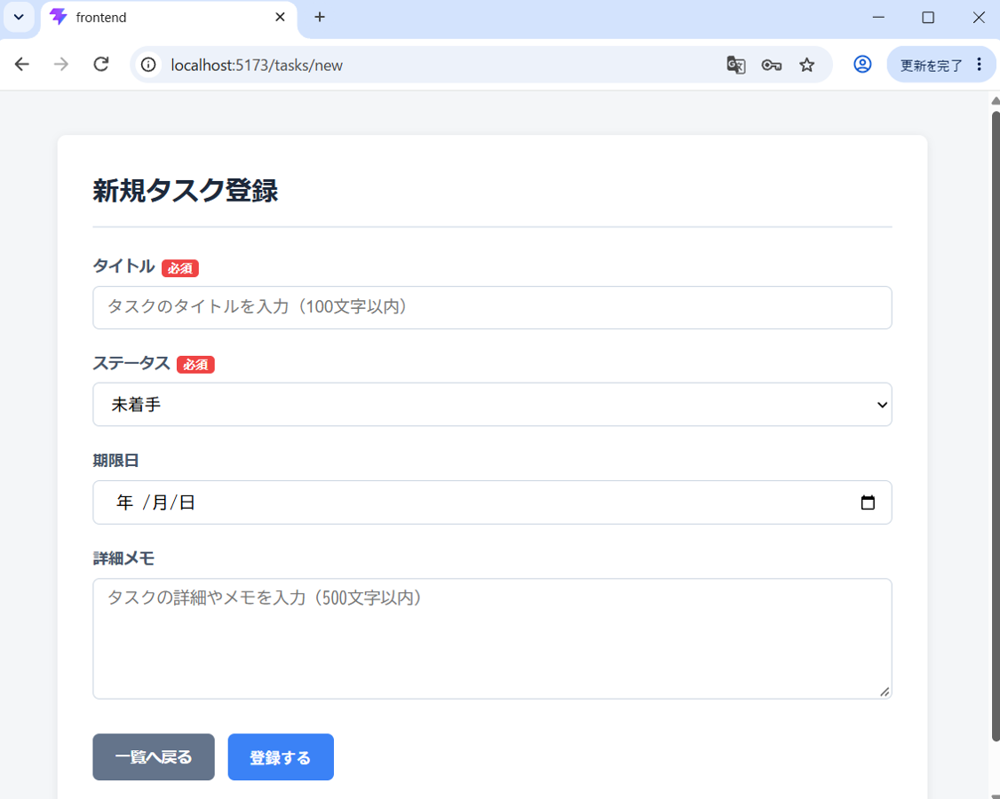
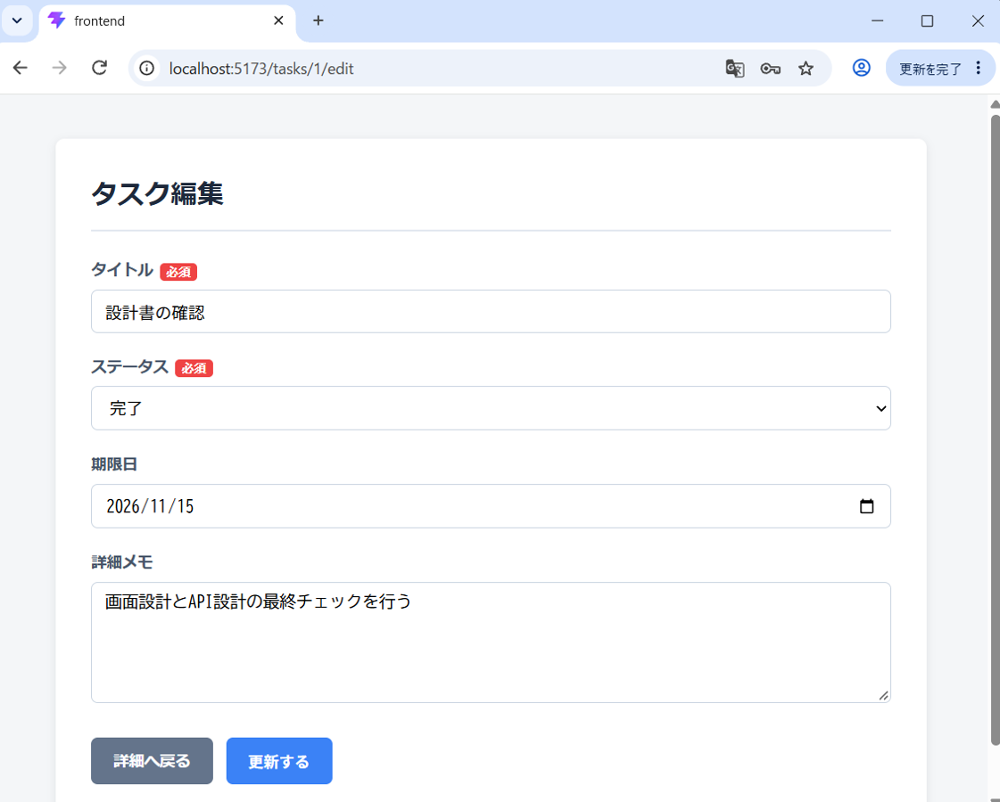
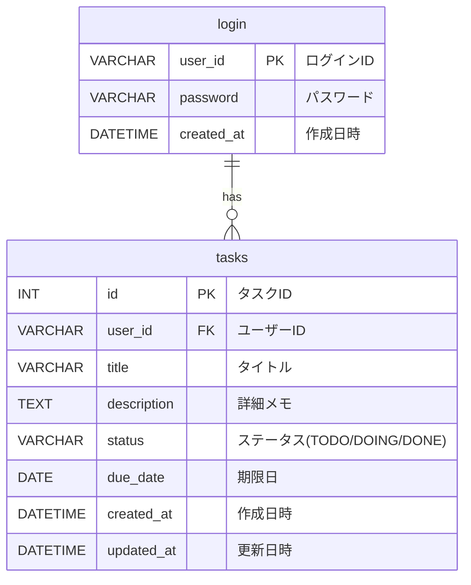

# SimpleTask
**迷わず使える、手帳のような超シンプルなタスク管理アプリ**

## 1. アプリケーションの概要
SimpleTaskは、日々のやるべきタスクを手帳のように記録・管理できる個人向けのタスク管理Webアプリケーションです。
余計な装飾や複雑な機能を省き、タスクの一覧確認・詳細表示・新規登録・編集・削除を簡単に操作できます。

## 2. 開発した背景・理由
日常の細かな予定や学習タスクが増えると、頭の中だけの管理では優先順位が曖昧になったり、うっかり忘れが発生したりする課題がありました。
既存の多機能なタスク管理ツールは設定項目が多く、余計混乱する場合があるので、「必要な機能だけ迷わずすぐに使える、紙の手帳のようなシンプルなWebアプリ」を目指して開発しました。

### 工夫した点・苦労した点
* **シンプルで直感的な画面設計**：画面遷移を整理し、一覧画面から詳細確認・削除へ、詳細画面から編集へと迷わず操作できることを意識しました。ステータスごとにバッジの色を変え、進捗がひと目で分かるように工夫しました。
* **セッションによる認証とデータ保護**：`HttpSession` を用いたログイン認証を実装し、ログイン中のユーザー自身のタスクのみ取得・更新・削除できるようバックエンド側で制御しました。
* **フロントエンドとバックエンドの連携**：CORS設定やAPIのリクエスト・レスポンス形式（JSON）を統一し、未入力時のバリデーションエラーや認証切れ時のログイン画面へのリダイレクトを丁寧に実装しました。

## 3. 画面一覧（デモ画像）

| ログイン画面 | トップページ |
| :---: | :---: |
|  |  |
| IDとパスワードによる認証画面 | 各機能への導線とログアウト機能 |

| タスク一覧画面 | タスク詳細画面 |
| :---: | :---: |
|  |  |
| 登録済みタスクの一覧表示と削除機能 | 選択したタスクの詳細メモや期限日の確認 |

| タスク登録画面 | タスク編集画面 |
| :---: | :---: |
|  |  |
| 必須チェック付きの新規タスク登録フォーム | 既存データを初期表示して更新するフォーム |

## 4. 主な使用技術（技術スタック）

| カテゴリ | 技術スタック |
| :--- | :--- |
| **Frontend** | JavaScript, React, Vite, React Router |
| **Backend** | Java 21, Spring Boot, Spring Data JPA |
| **Authentication** | HttpSession |
| **Database** | MySQL |
| **Build / Tools** | Maven, npm, Git, GitHub, draw.io, VS Code |

## 5. ER図（データベース設計）



## 6. ローカル環境での起動方法

### 必要環境
* Java 21
* Node.js
* MySQL

### 手順

**1. リポジトリをクローン**
```bash
git clone https://github.com/rose-come/simple-task.git
cd simple-task
```

**2. データベースの作成**
MySQLにログインし、`sql/init.sql` を実行してデータベース（`simple_task`）とテーブル、初期ユーザーを作成します。
* **テスト用ログインID**: `user01`
* **テスト用パスワード**: `password123`

**3. バックエンド（Spring Boot）の起動**
```bash
cd backend
./mvnw spring-boot:run
```
※ `http://localhost:8080` で起動します。

**4. フロントエンド（React）の起動（別ターミナルで実行）**
```bash
cd frontend
npm install
npm run dev
```
※ ブラウザで `http://localhost:5173/login` にアクセスして利用します。
